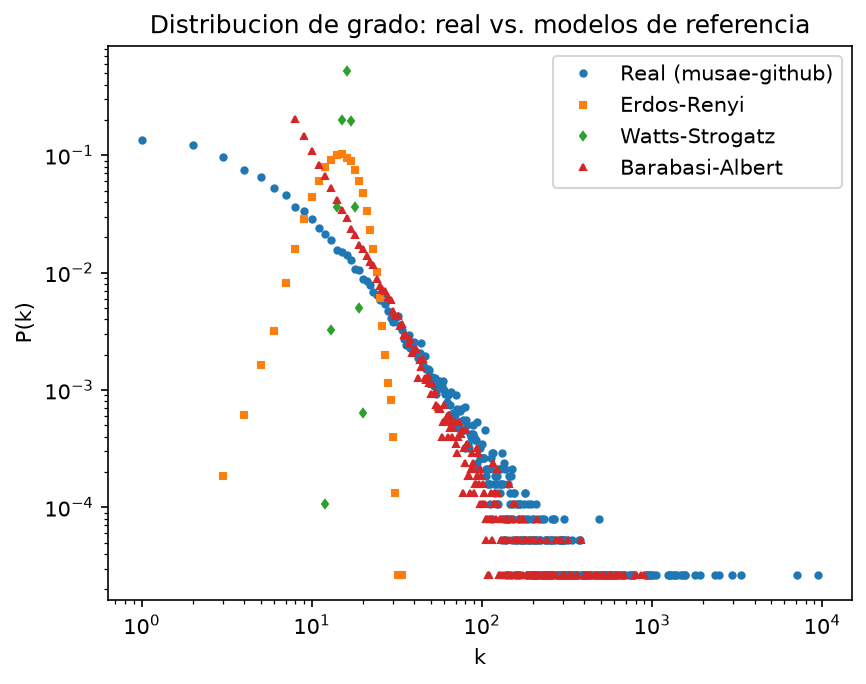
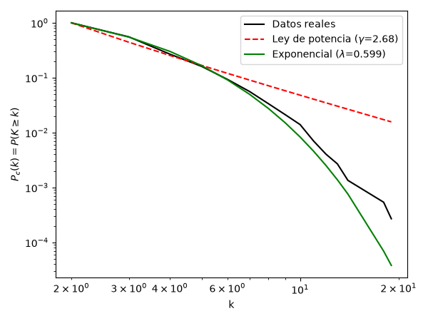
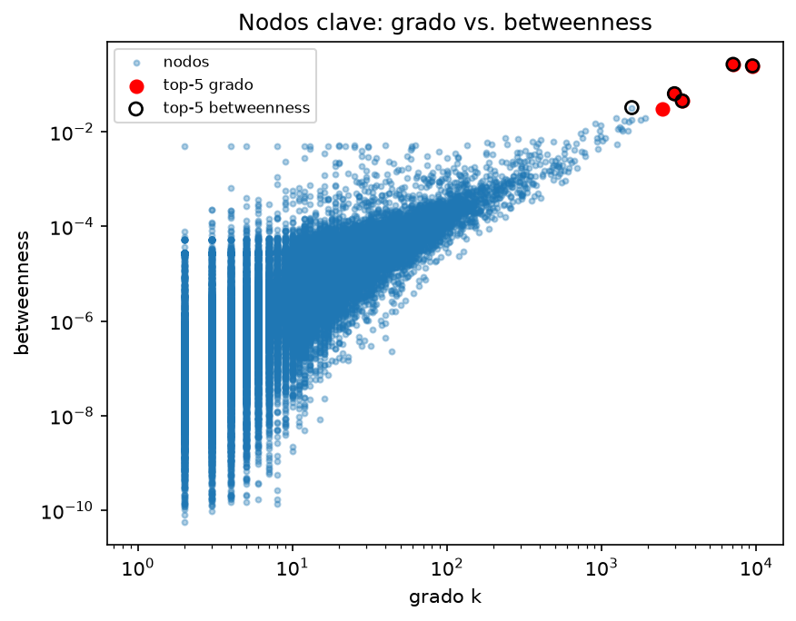

# Complex networks analysis

Statistical analysis of two real networks, a power grid and a developer social network, compared with the Erdős–Rényi, Watts–Strogatz and Barabási–Albert reference models. Written in Python (NetworkX, powerlaw, pandas) for the Complex Networks course of the M.Sc. in Advanced Physics (Computational Physics), UNED.


*Degree distribution of the GitHub developer network (≈37,700 nodes, ≈289,000 edges) against Erdős–Rényi, Watts–Strogatz and Barabási–Albert graphs of the same size. Only the preferential-attachment model reproduces the heavy tail.*

| Folder | Network | Analysis |
|---|---|---|
| [`01-power-grid`](01-power-grid) | Western US power grid (Watts & Strogatz, 1998): 4,941 nodes, 6,594 lines | Degree distribution with a power-law vs exponential fit (`powerlaw`, likelihood-ratio test); average path length, diameter and clustering vs an Erdős–Rényi graph and Watts–Strogatz graphs at several rewiring probabilities |
| [`02-github-social-network`](02-github-social-network) | GitHub developer network (SNAP `musae-github`) | Degree distribution, communities, betweenness vs degree, filtered visualisation, community vs developer type (web / ML), comparison with ER, WS and BA models; exports the graph for Gephi |

## Results

<p>


</p>

- **Left:** complementary cumulative degree distribution of the power grid, with power-law and exponential fits.
- **Right:** degree against betweenness centrality in the GitHub network.

## Data

The datasets are public and not included in this repository:

- **Power grid:** `power.mtx` from the [SuiteSparse Matrix Collection (Newman/power)](https://sparse.tamu.edu/Newman/power). Place it at `01-power-grid/data/power.mtx`.
- **GitHub network:** `musae_git_edges.csv` and `musae_git_target.csv` from [SNAP: GitHub social network](https://snap.stanford.edu/data/github-social.html). Place them next to `02-github-social-network/main.py`, or pass their paths as arguments.

## Usage

```bash
pip install -r requirements.txt
cd 01-power-grid && python main.py
cd 02-github-social-network && python main.py [edges.csv] [target.csv]
```

Code comments and plot labels are in Spanish.
